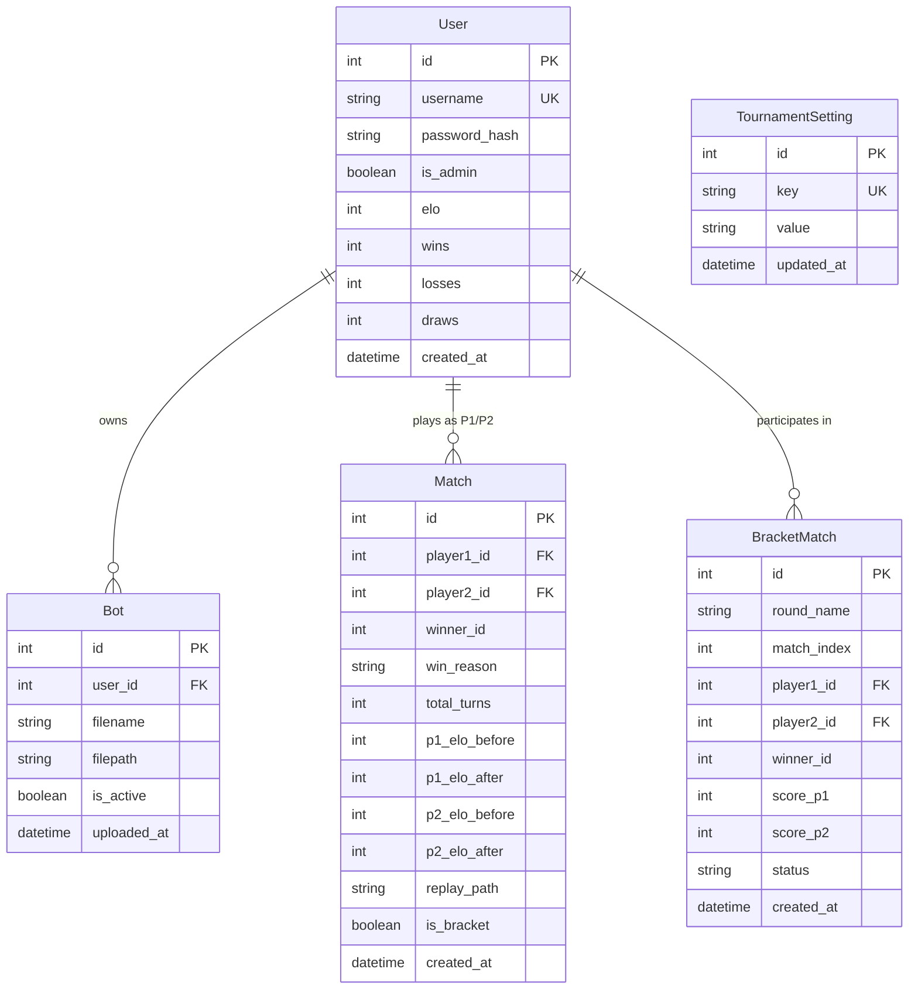

# Battlecode RPS 9x9 Platform — Technical Architecture Specification

> **Audience**: Technical evaluators, core software engineers, system maintainers.  
> **Source of Truth**: [`docs/CONTEXT_RESUME.md`](CONTEXT_RESUME.md)

---

## 1. System Overview & Architectural Principles

The Battlecode RPS 9x9 Platform is an autonomous tournament engine for 1v1 algorithmic bot duels, modeled after MIT Battlecode. The platform is designed under five central architectural principles:

1. **Zero-Node.js & Local-First**: The backend is pure Python (FastAPI + SQLAlchemy + SQLite WAL), and the presentation layer consists of native HTML5, CSS3 design tokens, and Vanilla JavaScript (ES2020+). No external Node.js runtime, npm package ecosystem, or client bundling pipelines are introduced.
2. **Centralized Safe Execution**: Bot source code executes server-side within isolated worker subprocesses bounded by strict 1.0-second CPU time limits and AST static analysis guards. Competitor source code is stored securely and never exposed to opponents.
3. **Multi-Machine Ready**: The application automatically inspects active network adapters to discover its Local Area Network (LAN) IP, binding to `0.0.0.0:8000` to facilitate multi-client LAN competitions out of the box.
4. **Single-Admin Security**: Only one administrator account exists across the persistence layer, governed by environment variables and enforced via seeder invariants and registration endpoint guards.
5. **Graduated Benchmark Ecosystem**: Five algorithmic benchmark boss bots reside in `server/bosses/`, allowing administrators to calibrate tournament ratings and provide players with verifiable benchmarks.

---

## 2. Multi-Tier System Architecture

```mermaid
graph TB
    subgraph Client Tier
        Browser["Web Browser (Vanilla JS Visualizer, Leaderboard, Admin Dashboard)"]
        CLI["Local Arena CLI (Offline Testing)"]
    end

    subgraph Server Tier (FastAPI)
        Router["FastAPI Application Router (/api & Web Templates)"]
        AuthGuard["Auth & Access Guard (Single-Admin & Route 303/403 Enforcement)"]
        BossMgr["Boss Deployment Manager (server/boss_manager.py)"]
        MatchQueue["Background Match Worker (Asynchronous Task Queue)"]
    end

    subgraph Engine Tier (Isolated Subprocess)
        Sandbox["AST Security Validator (engine/sandbox.py)"]
        Runner["Subprocess Match Runner (engine/runner.py, 1.0s timeout)"]
        Game["Core 9x9 RPS Game Engine (engine/game.py)"]
        BossBots["Server Boss Bots (server/bosses/*.py)"]
    end

    subgraph Persistence Tier (SQLite WAL)
        DB[("SQLite Database: app.db (WAL Mode)")]
        Replays[("JSON Replay Logs: replays/match_<id>.json")]
        BotStorage[("Bot Files: bots/<user_id>_<filename>.py")]
    end

    Browser -->|HTTP / Cookies| Router
    Router --> AuthGuard
    Router --> BossMgr
    Router --> MatchQueue
    BossMgr --> DB
    BossMgr --> BotStorage
    MatchQueue --> Sandbox
    MatchQueue --> Runner
    Runner --> Game
    Runner --> BossBots
    Router --> DB
    MatchQueue --> DB
    MatchQueue --> Replays
    Router --> BotStorage
    CLI --> Game
```

---

## 3. Core Engine Components

### 3.1 9x9 Rock-Paper-Scissors Chess Engine (`engine/game.py`)
- **Coordinate Matrix**: 9x9 grid (`row: 0..8`, `col: 0..8`):
  - Row 0 corresponds to rank 1 (Player 1 starting row).
  - Row 8 corresponds to rank 9 (Player 2 starting row).
  - Columns 0 through 8 map to files `a` through `i`.
- **Combat Hierarchy**:
  $$\text{Rock ('R')} \succ \text{Scissors ('S')} \succ \text{Paper ('P')} \succ \text{Rock ('R')}$$
  - Identical pieces block each other.
  - A piece cannot step into an enemy piece that beats it.
- **Victory Conditions**:
  1. **Goal Reach**: Player 1 piece reaches `i9` (`row=8, col=8`), or Player 2 piece reaches `a1` (`row=0, col=0`).
  2. **Wipeout**: Complete elimination of any single piece type (all 3 Rocks, all 3 Papers, or all 3 Scissors) of the opponent.
  3. **Turn Limit (200 Turns)**: The player with the highest total surviving piece count wins. In case of an exact tie, the match is evaluated as a Draw.

### 3.2 AST Static Security Validator (`engine/sandbox.py`)
Uploaded Python bot files are analyzed prior to filesystem storage and execution. The validator inspects the Abstract Syntax Tree (AST) against 74 attack patterns:
- **Forbidden Imports**: Blocks `os`, `sys`, `subprocess`, `socket`, `shutil`, `ctypes`, `threading`, `multiprocessing`, `requests`, `urllib`, `builtins`, `importlib`.
- **Whitelisted Modules**: Allows safe standard modules: `math`, `random`, `copy`, `collections`, `heapq`, `itertools`, `typing`, `dataclasses`, `engine.game`.
- **Dangerous Built-ins**: Prohibits `open`, `eval`, `exec`, `compile`, `__import__`, `globals`, `locals`.
- **Dunder Reflection Traps**: Disallows introspection via `__subclasses__`, `__builtins__`, `__globals__`, `__code__`, `__bases__`, `__class__`, `__mro__`, `__dict__`.
- **Entrypoint Enforcement**: Rejects code without a top-level `def get_move(board, my_player, history)`.

### 3.3 Isolated Subprocess Match Runner (`engine/runner.py`)
- Executes matches in a standalone Python child process.
- Each turn call to `get_move(...)` is guarded by a strict **1.0-second timeout**.
- Any bot that times out, raises an unhandled exception, or returns an invalid move forfeits:
  - `win_reason = 'timeout'`
  - `win_reason = 'error'`
  - `win_reason = 'invalid_move'`
- Produces standardized JSON replays containing move-by-move algebraic notations (`SAN`) and timestamps.

---

## 4. Server-Side Boss Benchmark Framework (`server/bosses/`, `server/boss_manager.py`)

To provide standardized skill benchmarks and automated match calibration, the platform incorporates five server-side boss bots in `server/bosses/`:

| Level | Boss Slug | File | Default Elo | Strategic Specialization |
| :--- | :--- | :--- | :--- | :--- |
| **Level 1** | `novice` | `server/bosses/novice_bot.py` | 1000 | Immediate goal takes and opportunistic captures; uniform random fallback. |
| **Level 2** | `rusher` | `server/bosses/rusher_bot.py` | 1200 | Chebyshev distance minimization towards goal square with basic threat evasion. |
| **Level 3** | `sentinel` | `server/bosses/sentinel_bot.py` | 1400 | Home goal perimeter guarding combined with targeted wipeout of opponent's scarce piece type. |
| **Level 4** | `tactician` | `server/bosses/tactician_bot.py` | 1600 | 2-ply Minimax search with Alpha-Beta pruning, scoring piece values, threats, and goal distances. |
| **Level 5** | `apex` | `server/bosses/apex_bot.py` | 1800 | Dynamic-depth Minimax, piece sacrifice traps (baiting), board influence clustering, and endgame convergence. |

### Boss Deployment Lifecycle (`server/boss_manager.py`)
1. **Administrative Access Only**: Endpoints `/api/admin/bosses` and `POST /api/admin/bosses/deploy` require active administrator session credentials.
2. **Shadow Account Provisioning**: Deploying a boss idempotently provisions a dedicated `User` account (`boss_<slug>`), persists the bot code to `bots/`, and marks the bot active with its calibrated baseline Elo.
3. **Safe Retraction**: Retracting a boss sets its bot status to inactive without compromising historical match integrity or corrupting replay logs.

---

## 5. Persistence & Database Design (`server/models.py`)

The platform utilizes SQLite configured with Write-Ahead Logging (`PRAGMA journal_mode=WAL; PRAGMA synchronous=NORMAL;`) to ensure non-blocking concurrent reads while background workers record match outcomes.



### Dynamic Schedule Persistence (`TournamentSetting`)
Rather than relying on static configuration file edits, the system stores operational scheduling keys in `TournamentSetting`:
- `start_time`: Time string formatted `HH:MM` (default: `"19:00"`).
- `end_time`: Time string formatted `HH:MM` (default: `"21:00"`).
- `ffa_mode`: Operational state (`"auto"`: window-checked; `"true"`: forced open; `"false"`: forced closed).
- `elo_multiplier`: Float multiplier string between `1.0` and `3.0`.
- `current_day`: Integer day index from `1` to `n`.

The helper function `is_ffa_portal_open(config, current_time_str, db_settings)` resolves schedule evaluation dynamically at request time.

---

## 6. Minimalist Presentation Layer & CSS Design Tokens

The user interface adheres to a developer-grade Charcoal/Slate design system implemented via native CSS custom properties in `web/static/css/style.css`:

```css
:root {
  --bg-main: #0d1117;
  --bg-surface: #161b22;
  --border-subtle: #30363d;
  --text-primary: #f0f6fc;
  --text-muted: #8b949e;
}
```

Key visual characteristics:
- **Zero Decorative Gradients**: Surfaces use flat, opaque neutral tones (`#0d1117` and `#161b22`), eliminating distracting color animations and neon halos.
- **Crisp Data Presentation**: Leaderboard and profile match history render with high-contrast borders (`#30363d`) and mono-spaced numerical metrics.
- **Optimized Replay Visualizer (`web/static/js/visualizer.js`)**: Board cells display clean borders, high-contrast pieces, explicit file/rank notations (`a1` to `i9`), and responsive scrubber controls.

---

## 7. Security and Access Control Specification

1. **Single-Admin Invariant**:
   - Exactly one administrator exists.
   - Enforced by environment variables `ADMIN_USERNAME` and `ADMIN_PASSWORD`.
   - Registration endpoint `/api/auth/register` rejects any attempt to claim the admin username with HTTP 400.
   - Application startup routine demotes any spurious admin records (`is_admin = False`).
2. **Route Authorization Guard**:
   - The `/admin` web route inspects `current_user` session cookies.
   - Unauthenticated visitors receive an immediate HTTP 303 Redirect to `/login?next=/admin`.
   - Authenticated non-admin users receive an HTTP 403 Forbidden response.
   - Navigation links to the Admin portal are conditionally rendered in `web/templates/base.html` exclusively when `current_user.is_admin` is true.

---

## 8. Tournament & Rating Mathematics (`server/tournament.py`)

### 8.1 Dynamic Daily Elo Formula
During regular FFA tournament days, match outcomes adjust ratings using the daily multiplier $x \in [1.0, 3.0]$:
$$E_A = \frac{1}{1 + 10^{(R_B - R_A)/400}}, \quad E_B = \frac{1}{1 + 10^{(R_A - R_B)/400}}$$
$$\Delta R_A = \text{round}\Big(x \times K \times (S_A - E_A)\Big), \quad K = 32$$
$$\Delta R_B = \text{round}\Big(x \times K \times ((1 - S_A) - E_B)\Big)$$
Ratings are clamped at zero: $R_{new} = \max(0, R_{old} + \Delta R)$.

### 8.2 Composite Playoff Tournament Score
On the final championship day, Top 8 or Top 16 bots contest a Single Elimination BO3 bracket:
$$\text{Score}_{final} = w_{elo} \cdot \text{RankPoints}_{elo} + w_{bracket} \cdot \text{BracketPoints}$$

---

## 9. Multi-Machine Network Topology

```text
       [ Host Server Machine ]
   http://0.0.0.0:8000 (Local IP: 192.168.1.15)
              |
       +------┴--------------------------+
       | Local Area Network (Wi-Fi/LAN)  |
       |                                 |
       v                                 v
[ Competitor Machine 1 ]        [ Competitor Machine 2 ]
http://192.168.1.15:8000       http://192.168.1.15:8000
Uploads bot & challenges       Inspects matches & replay
```

The server binds to `0.0.0.0:8000`. On startup, `get_lan_ip()` resolves the host address and displays the LAN network URL on the console for competitors on the local network.
