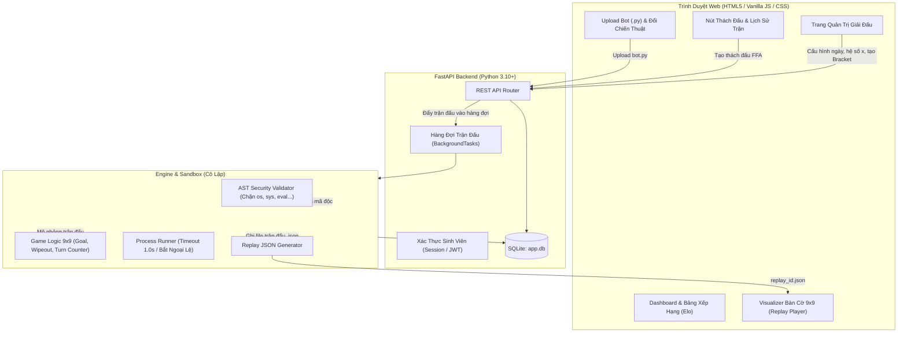

# Đặc Tả Kiến Trúc Hệ Thống: Battlecode RPS Chess Platform (Bản 9x9)

> **Mục tiêu**: Xây dựng nền tảng thi đấu thuật toán (Battlecode-like) cho sinh viên viết bot Python chơi cờ Oẳn Tù Tì 9×9, phục vụ giải đấu nhiều ngày với hệ số Elo ngẫu nhiên và chung kết loại trực tiếp (Bracket).
> **Quy mô**: MVP 20 người chơi, mở rộng 100+ người chơi.
> **Triết lý thiết kế**: Tối giản công nghệ (Zero-Node.js, Pure Python + Vanilla JS), Local-First, bảo mật tuyệt đối mã nguồn bot, và hỗ trợ tối đa cho nhóm 4 người làm việc cùng nhiều LLM khác nhau.

---

## 1. Tổng Quan Kiến Trúc & Cấu Trúc Dự Án

### 1.1 Sơ Đồ Khối & Luồng Dữ Liệu



### 1.2 Cấu Trúc Thư Mục Chuẩn Hóa

```text
Battlecode-clone0810/
├── config/
│   └── tournament.yaml          # Cấu hình giải đấu (số ngày n, giờ mở, hệ số x, max turns)
├── docs/                        # Tài liệu dự án & ngữ cảnh cho LLM
│   ├── ARCHITECTURE.md          # Chi tiết thiết kế kỹ thuật
│   ├── BOT_GUIDE.md             # Hướng dẫn thí sinh viết bot & hàm API
│   ├── CONTEXT_RESUME.md        # File ngữ cảnh nạp cho LLM khi luân chuyển máy/người
│   └── superpowers/specs/       # Bản đặc tả kỹ thuật chi tiết
├── engine/                      # Core Game Logic (Python thuần, không phụ thuộc Web)
│   ├── __init__.py
│   ├── game.py                  # Khởi tạo bàn cờ, kiểm tra hợp lệ, luật ăn quân, tính thắng
│   ├── runner.py                # Chạy trận đấu giữa 2 bot, giám sát thời gian (1.0s)
│   └── sandbox.py               # Phân tích AST, cấm module độc hại (os, sys, socket...)
├── server/                      # FastAPI Web Server
│   ├── __init__.py
│   ├── main.py                  # Entrypoint khởi chạy server
│   ├── database.py              # Kết nối SQLite và phiên làm việc SQLAlchemy
│   ├── models.py                # Schema CSDL: User, Bot, Match, TournamentDay, BracketMatch
│   ├── schemas.py               # Pydantic schemas cho dữ liệu vào/ra API
│   ├── routes/
│   │   ├── auth.py              # Đăng ký, đăng nhập
│   │   ├── bots.py              # Nộp code bot, tải lại phiên bản bot cá nhân
│   │   ├── matches.py           # Thách đấu FFA, lấy lịch sử trận, lấy replay JSON
│   │   ├── leaderboard.py       # BXH Elo, thông tin hồ sơ người chơi
│   │   └── admin.py             # Điều khiển giải, kích hoạt Bracket, đổi hệ số x
│   └── tournament.py            # Tính toán Elo (nhân hệ số x), thuật toán sinh bảng Bracket
├── web/                         # Giao diện tĩnh (kế thừa từ resources/HTML-game-project-main)
│   ├── static/
│   │   ├── css/style.css        # Giao diện bàn cờ tối, thẻ quân, hiệu ứng
│   │   └── js/
│   │       ├── api.js           # Giao tiếp API với server
│   │       └── visualizer.js    # Trình chiếu replay bàn cờ 9x9 (Play, Pause, Step, Slider)
│   └── templates/               # Giao diện Jinja2
│       ├── base.html            # Layout chung (Navbar, Header)
│       ├── index.html           # Trang chủ & Bảng xếp hạng Elo
│       ├── login.html           # Đăng nhập / Đăng ký
│       ├── profile.html         # Hồ sơ cá nhân, nộp code bot & lịch sử đấu
│       ├── replay.html          # Trang xem lại trận đấu tương tác
│       └── admin.html           # Dashboard quản trị giải đấu
├── starter_kit/                 # Bộ tài liệu gửi cho sinh viên tải về máy
│   ├── bot_template.py          # Bot mẫu (SimpleBot)
│   ├── local_arena.py           # Chạy thử nghiệm 2 bot đối đầu trên máy cá nhân
│   └── README.md                # Hướng dẫn sử dụng starter kit
├── tests/                       # Unit tests tự động
│   ├── test_game.py             # Test các luật cờ, ăn quân, ô đích, diệt sạch quân
│   ├── test_sandbox.py          # Test bắt mã độc AST
│   ├── test_runner.py           # Test timeout, crash, sinh replay JSON
│   └── test_tournament.py       # Test tính Elo và sinh nhánh Bracket
├── TASKS.md                     # Bảng phân chia công việc nhóm 4 người & tiến độ
├── requirements.txt             # Danh sách thư viện Python tối giản
└── main.py                      # File khởi động 1 lệnh duy nhất
```

---

## 2. Luật Game Oẳn Tù Tì 9×9 & Đặc Tả Bot API

### 2.1 Luật Game Trên Bàn Cờ 9×9
1. **Bàn cờ**: Kích thước 9×9 ô. Tọa độ từ `a1` đến `i9` (tương ứng ma trận `board[row][col]` với `row: 0..8`, `col: 0..8`).
2. **Loại quân**:
   - `R` (Đấm - Rock ✊), `P` (Lá - Paper ✋), `S` (Kéo - Scissors ✌).
   - Quy tắc tương khắc: `R > S`, `S > P`, `P > R`.
3. **Bố trí ban đầu**:
   - **Player 1 (Đỏ - Đi trước)**: Hàng 0 (Rank 1): `[R, R, R, P, P, P, S, S, S]`.
   - **Player 2 (Xanh - Đi sau)**: Hàng 8 (Rank 9): `[S, S, S, P, P, P, R, R, R]`.
   - Các hàng từ 1 đến 7 ban đầu trống (`None`).
4. **Quy tắc di chuyển & Ăn quân**:
   - Mỗi quân đi 1 ô theo 8 hướng (như quân Vua trong cờ vua).
   - Ô đích đến phải trống **hoặc** chứa quân của đối phương mà quân mình **thắng Oẳn Tù Tì**.
   - Cùng loại quân: chặn nhau, không được đi vào. Thua Oẳn Tù Tì: không được đi vào.
5. **Điều kiện Thắng Cuộc**:
   - **Chạm đích (Goal)**: Player 1 đưa bất kỳ quân nào vào ô `i9` (row 8, col 8); hoặc Player 2 đưa quân vào ô `a1` (row 0, col 0).
   - **Diệt sạch 1 loại quân (Wipeout)**: Ăn hết cả 3 quân cùng 1 loại (toàn bộ R, toàn bộ P, hoặc toàn bộ S) của đối phương.
   - **Xử thua kỹ thuật (Forfeit)**: Bot vi phạm timeout (quá 1.0 giây/turn), crash sinh lỗi ngoại lệ, hoặc sinh nước đi không hợp lệ.
   - **Hết lượt (Stalemate / Max Turns)**: Trận đấu kéo dài tối đa **200 turns**. Nếu chưa ai đạt điều kiện trên, bên nào còn nhiều tổng số quân hơn sẽ thắng; nếu bằng nhau thì tính **Hòa (Draw)**.

### 2.2 Đặc Tả Interface Cho Bot Python (`bot.py`)

Mỗi sinh viên nộp 1 file Python duy nhất (ví dụ `my_bot.py`). Bot phải hiện thực hàm chuẩn:

```python
def get_move(board: list[list[dict | None]], my_player: int, history: list[dict]) -> tuple[tuple[int, int], tuple[int, int]]:
    """
    Args:
        board: Ma trận 9x9, board[r][c] là None hoặc {'type': 'R'|'P'|'S', 'player': 1|2}
        my_player: Số 1 (P1 - Đỏ) hoặc 2 (P2 - Xanh)
        history: Danh sách các nước đi trước đó [{'player': 1, 'from': (r, c), 'to': (r, c), 'san': '...'}]

    Returns:
        ((from_row, from_col), (to_row, to_col))
    """
    pass
```

Đồng thời, hệ thống cung cấp lớp hỗ trợ `GameState` trong thư viện chuẩn để bot có thể gọi:
- `game.get_valid_moves(player)`: Trả về danh sách các nước đi hợp lệ `[((r1, c1), (r2, c2)), ...]`.
- `game.is_goal(r, c, player)`: Kiểm tra ô đích.

---

## 3. Cơ Chế Chạy Trận Đấu & Bảo Mật (Runner & Sandbox)

### 3.1 Bộ Lọc Mã Độc AST (`engine/sandbox.py`)
Trước khi lưu và chạy bot của thí sinh, hệ thống duyệt cây cú pháp trừu tượng (AST) của file Python:
- **Cấm hoàn toàn các thư viện hệ thống**: `os`, `sys`, `subprocess`, `socket`, `shutil`, `ctypes`, `threading`, `multiprocessing`, `requests`, `urllib`.
- **Cấm các hàm nguy hiểm**: `eval`, `exec`, `open`, `__import__`, `globals`, `locals`, `compile`.
- **Danh sách thư viện cho phép (Whitelist)**: `math`, `random`, `copy`, `collections`, `heapq`, `itertools`, `typing`.
- Nếu phát hiện vi phạm, hệ thống từ chối nhận bot và báo lỗi ngay trên giao diện nộp code.

### 3.2 Bộ Điều Khiển Trận Đấu (`engine/runner.py`)
- Mỗi trận đấu chạy trong một tiến trình con riêng biệt (`subprocess`).
- **Thời gian**: Mỗi nước đi có giới hạn cứng $1.0$ giây.
- **Dữ liệu Replay**: Sau khi trận đấu kết thúc, runner ghi ra file `replays/match_<id>.json` gồm:
  - Thông tin 2 người chơi (tên bot, id người chơi).
  - Kết quả: `winner: 1 | 2 | null`, `win_reason: 'goal' | 'wipeout' | 'timeout' | 'error' | 'max_turns'`.
  - Toàn bộ danh sách snapshot các nước đi để phục vụ trình chiếu replay trên Web.

---

## 4. Thể Thức Thi Đấu, Bảng Xếp Hạng & Thuật Toán Giải

### 4.1 Giai Đoạn Vòng Bảng (Ngày 1 đến Ngày $n$)
- **Khung giờ mở cổng**: Cấu hình trong `config/tournament.yaml` (mặc định 19:00 - 21:00 hàng ngày). Ngoài khung giờ này, thí sinh vẫn có thể nộp bot và test local nhưng không được đấu rank.
- **Thách đấu tự do (FFA)**: Trong khung giờ, bất kỳ ai cũng có thể vào Bảng Xếp Hạng bấm "Thách đấu" bất kỳ người chơi nào. Trận đấu tự động đưa vào hàng đợi và chạy ngầm.
- **Hệ số ngẫu nhiên $x$ theo ngày**:
  - Mỗi ngày hệ thống áp dụng một hệ số $x \in [1.0, 3.0]$ (Admin có thể tự điều chỉnh trên trang Admin).
  - Công thức tính điểm Elo sau trận:
    $$\Delta\text{Elo} = \text{round}(x \times K \times (S - E))$$
    Với $K = 32$, $S \in \{1.0 \text{ (Thắng)}, 0.5 \text{ (Hòa)}, 0.0 \text{ (Thua)}\}$, và xác suất kỳ vọng:
    $$E_A = \frac{1}{1 + 10^{(R_B - R_A)/400}}$$
  - Người thắng nhận $+\Delta\text{Elo}$, người thua trừ $-\Delta\text{Elo}$ (không để Elo rơi xuống dưới 0).

### 4.2 Giai Đoạn Chung Kết (Ngày $n+1$: Bracket Tournament)
- Đóng cổng nộp code và thách đấu FFA.
- Lấy Top 8 (hoặc Top 16) người có điểm Elo cao nhất vào bảng đấu loại trực tiếp (Single Elimination Bracket).
- Từng cặp đấu theo thể thức **Best of 3 (BO3)**:
  - Ván 1: Player A đi trước (P1), Player B đi sau (P2).
  - Ván 2: Đổi lượt: Player B đi trước (P1), Player A đi sau (P2).
  - Ván 3 (nếu hòa 1-1): Phân định thắng thua.
- Hệ thống tự động sinh kết quả và hiển thị sơ đồ cây giải đấu (Tournament Bracket Tree) trên web.

### 4.3 Công Thức Xếp Hạng Chung Cuộc
Sau khi kết thúc Ngày $n+1$, thứ hạng toàn giải tính theo trọng số:
$$\text{Score}_{\text{final}} = 0.5 \times \text{Elo}_{\text{chuẩn hóa}} + 0.5 \times \text{BracketScore}$$
- Vô địch Bracket: 100 điểm.
- Á quân: 80 điểm.
- Top 4: 60 điểm.
- Top 8: 40 điểm.
- Các vị trí còn lại tính theo Elo vòng bảng.

---

## 5. Phân Chia Công Việc Nhóm 4 Người & Quy Trình Multi-LLM

### 5.1 Phân Công Chi Tiết 4 Thành Viên

```text
+------------------+-------------------------------------------------------+
| Thành Viên       | Trách Nhiệm & Module Quản Lý                          |
+------------------+-------------------------------------------------------+
| Member 1         | • Core Engine: engine/game.py, engine/sandbox.py      |
| (Engine Lead)    | • Starter Kit: starter_kit/ (bot mẫu, local_arena.py) |
|                  | • Unit tests: tests/test_game.py, test_sandbox.py     |
+------------------+-------------------------------------------------------+
| Member 2         | • Runner & Queue: engine/runner.py, server/queue.py   |
| (Execution Lead) | • Timeout, xử lý ngoại lệ, sinh file replay JSON      |
|                  | • Unit tests: tests/test_runner.py                    |
+------------------+-------------------------------------------------------+
| Member 3         | • Backend API & Database: server/models.py, routes/   |
| (Backend Lead)   | • Tournament Logic: server/tournament.py, Elo formula |
|                  | • Config parser: config/tournament.yaml               |
+------------------+-------------------------------------------------------+
| Member 4         | • Web UI & Visualizer: web/templates/, web/static/    |
| (Frontend Lead)  | • Tích hợp bàn cờ từ HTML-game-project thành Replayer |
|                  | • Dashboard, Bảng xếp hạng Elo, Trang Admin           |
+------------------+-------------------------------------------------------+
```

### 5.2 Cơ Chế Lưu Ngữ Cảnh & Master Prompt Cho AI (Context Resume)
- File `docs/CONTEXT_RESUME.md` đóng vai trò "bộ nhớ dài hạn" lưu trong repo.
- Bất kỳ thành viên nào khi mở session AI mới (Claude, Gemini, GPT-4o, Cursor...) chỉ cần gửi prompt sau:
  > *"Tôi đang làm việc trên dự án Battlecode RPS 9x9. Hãy đọc file `docs/CONTEXT_RESUME.md` và `TASKS.md` để nắm kiến trúc và quy ước. Tôi là Member [1/2/3/4], hãy giúp tôi giải quyết Task [X] theo chuẩn code đã đề ra."*

### 5.3 Quản Trị Tiến Độ & Quy Tắc Human-In-The-Loop
- Toàn bộ task được liệt kê trong `TASKS.md`.
- **Quy tắc vàng**: AI chỉ viết code và gợi ý lệnh test. Thành viên phải tự chạy lệnh kiểm thử trên máy cá nhân (`pytest`, `python local_arena.py`). Chỉ khi test **PASS** thì mới đánh dấu `[x]` và commit Git.

---

## 6. Hướng Dẫn Cài Đặt & Khởi Chạy Local-First

1. **Yêu cầu môi trường**:
   - Python $\ge$ 3.10.
   - Không cần Node.js, không cần Docker (cho phiên bản MVP).
2. **Cài đặt thư viện**:
   ```bash
   pip install -r requirements.txt
   ```
   *(Các thư viện chính: `fastapi`, `uvicorn`, `sqlalchemy`, `pyyaml`, `jinja2`, `python-multipart`, `pytest`)*.
3. **Khởi chạy máy chủ**:
   ```bash
   python main.py
   ```
   Server tự động tạo CSDL `app.db`, seed dữ liệu mẫu và mở web tại `http://localhost:8000`.
4. **Chia sẻ cho người khác trong mạng / Internet**:
   - Trong cùng mạng LAN: Mở qua `http://<IP_MÁY_CHỦ>:8000`.
   - Khác mạng qua Internet: Chạy công cụ miễn phí 1 lệnh duy nhất:
     ```bash
     cloudflared tunnel --url http://localhost:8000
     ```
     Nhận ngay 1 đường link HTTPS công khai để 20 - 100 người chơi truy cập nộp bot từ bất cứ đâu.
