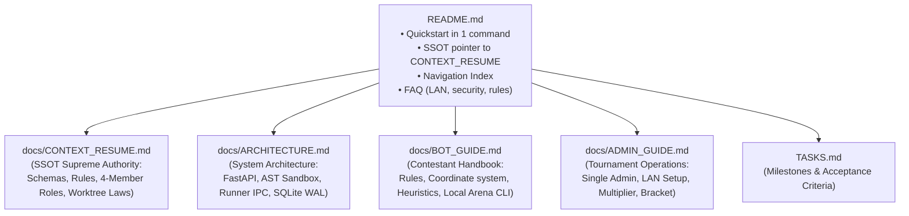

# 📐 System Design Spec: Multi-Machine Deployment, Single-Admin Enforcement, and Documentation Hierarchy

> **Date**: 2026-10-09
> **Status**: APPROVED
> **Target Branch**: `feat-docs-and-single-admin`
> **Author**: Antigravity & User Pair

---

## 1. Problem Statement & Motivation
1. **Multi-Machine LAN Networking**: The Battlecode RPS platform needs to allow multiple students on different laptops to access the platform web interface, submit bots, challenge opponents, and view match replays concurrently over the Local Area Network (LAN).
2. **Single-Admin Enforcement**: The system must have exactly **ONE** designated administrator account. No student or external user should be able to register another admin account or elevate privileges. Admin credentials should be configurable via environment variables (`ADMIN_USERNAME`, `ADMIN_PASSWORD`).
3. **Persistent Git Worktrees & Meta-Files Policy**: To maintain repository hygiene, feature development must always happen in isolated git worktrees (`.worktrees/`). The `resources/` folder and meta files (`.git/`, `.gemini/`, `GEMINI.md`, `CLAUDE.md`, `docs/CONTEXT_RESUME.md`) must permanently remain at the root and must never be duplicated into worktrees.
4. **Documentation Redundancy & Fragmentation**: `README.md` currently duplicates extensive game rules and bot signatures already present in `docs/CONTEXT_RESUME.md`. The documentation lacks dedicated, targeted guides for different stakeholders (contestants, operators, evaluators).

---

## 2. Architecture & Design Specifications

### 2.1 Multi-Machine LAN Networking & Server Banner
- **Network Interface**: FastAPI / Uvicorn continues binding to `0.0.0.0:8000`.
- **Automatic LAN IP Detection**: In `main.py`, automatically resolve the machine's primary local network IP (via `socket.gethostbyname_ex` or UDP connection probe to `8.8.8.8`) and display both localhost and LAN URLs in the console banner:
  ```text
  ========================================================================
             BATTLECODE 9x9 ROCK-PAPER-SCISSORS PLATFORM
  ========================================================================
    Local URL:          http://localhost:8000
    LAN Network URL:    http://192.168.1.x:8000 (Share with other machines)
    Admin Dashboard:    http://localhost:8000/admin
    API Documentation:  http://localhost:8000/docs
  ========================================================================
  ```
- **Firewall & Troubleshooting Guide**: Document firewall port 8000 opening steps for Windows / Linux / macOS in `docs/ADMIN_GUIDE.md`.

### 2.2 Single-Admin Security Enforcement
- **Environment Variables**:
  - `ADMIN_USERNAME`: Defaults to `"admin"` if not provided.
  - `ADMIN_PASSWORD`: Defaults to `"admin123"` if not provided.
- **Seeding & Synchronization (`main.py`)**:
  - `seed_admin_and_starter_bots()` verifies the designated admin user exists.
  - Updates password if `ADMIN_PASSWORD` changes.
  - Sets `is_admin = True` strictly on this user.
  - Enforces invariant: any other existing user with `is_admin = True` is downgraded to `is_admin = False`.
- **Registration Guard (`server/routes/auth.py`)**:
  - The `/api/auth/register` endpoint strictly prevents registering any username matching the admin username (case-insensitive check against `admin` or `ADMIN_USERNAME`).
  - No client-facing registration payload can set `is_admin=True`.

### 2.3 Documentation Hierarchy & Content Plan



#### Detailed Breakdown:
1. **`README.md`**:
   - Concise project summary & badges.
   - Quickstart (2-line setup: `pip install -r requirements.txt`, `python main.py`).
   - SSOT pointer urging all contributors to read `docs/CONTEXT_RESUME.md`.
   - Comprehensive Navigation Table linking to all specialized documents.
   - **Rich FAQ Section**:
     - *Q: How do other machines on the LAN connect?*
     - *Q: Can other participants view my bot code?*
     - *Q: How does the single admin account work?*
     - *Q: What are the win conditions and timeouts?*
     - *Q: How can I develop and test offline without the server?*
2. **`docs/ARCHITECTURE.md`**:
   - System diagram & data flow.
   - 4-Tier design: Web UI, REST API & Queue, Execution Engine & Sandbox, Persistence.
   - AST Security Validator threat model & AST visitor mechanics.
   - Isolated Subprocess Runner & IPC architecture (1.0s timeout per move).
   - SQLite WAL mode concurrency details.
3. **`docs/BOT_GUIDE.md`**:
   - Comprehensive contestant manual.
   - 9x9 board matrix, coordinate convention ($a1$ to $i9$).
   - Rock-Paper-Scissors hierarchy ($R > S$, $S > P$, $P > R$).
   - Goal reaching ($i9$ for P1, $a1$ for P2) & Wipeout win condition.
   - `get_move(board, my_player, history)` API specification.
   - Whitelisted Python modules vs banned libraries.
   - Offline simulation with `starter_kit/local_arena.py`.
   - Heuristic bot design tips and strategic principles.
4. **`docs/ADMIN_GUIDE.md`**:
   - Guide for tournament organizers.
   - Single Admin security model & credential customization.
   - Multi-machine LAN setup, IP discovery, and Windows Firewall configuration.
   - Daily FFA tournament portal hours & dynamic multiplier $x \in [1.0, 3.0]$.
   - Single-elimination Bracket generation (Top 8 / Top 16 BO3) on Day $n+1$.
   - Final composite scoring calculation.

### 2.4 Persistent Git Worktrees & Meta-Files Law
Update `docs/CONTEXT_RESUME.md` and `GEMINI.md` to permanently record:
1. **Rule: Mandatory Worktree Isolation**: All feature branches must be developed inside `.worktrees/<branch-name>`.
2. **Rule: Root Meta-File & Reference Preservation**:
   - `resources/` lives exclusively at repo root (never duplicated or moved).
   - `.git/`, `.gemini/`, `GEMINI.md`, `CLAUDE.md`, and `docs/CONTEXT_RESUME.md` remain at repo root.

---

## 3. Verification & Testing Strategy
1. **Unit Tests for Single Admin**:
   - Test registration rejection for admin username in `tests/test_api.py`.
   - Test env var configuration for `ADMIN_USERNAME` and `ADMIN_PASSWORD` in `tests/test_database.py` / `tests/test_e2e.py`.
2. **LAN Host / IP Detection Verification**:
   - Verify `main.py` parses `--host` and prints LAN URL cleanly.
3. **Documentation Integrity Verification**:
   - Verify all file links in `README.md` point to existing files.
   - Verify no broken markdown references across `docs/`.
4. **Regression Test Suite**:
   - Run `pytest -v` across entire suite (all 167+ tests must pass).
